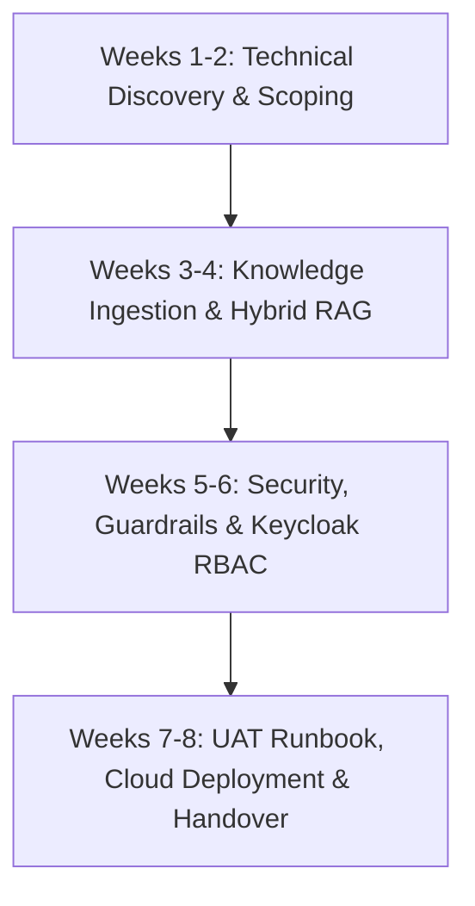
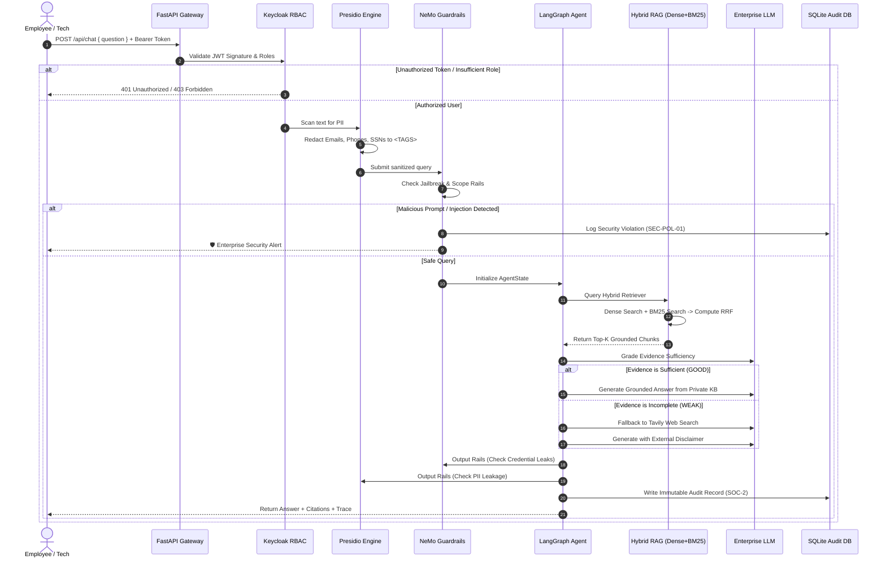

# FDE Playbook & Production Architecture Guide
## Enterprise IT Support Agentic RAG Copilot (NovaRetail)

---

## 1. Role of the Forward Deployed Engineer (FDE)

A **Forward Deployed Engineer (FDE)** is a specialized AI engineer who embeds directly with enterprise customers to translate complex business problems into production-grade AI systems. 

Unlike traditional software consultants who stop at slide decks or research scientists who deliver disconnected notebooks, the FDE owns the full lifecycle:

```text
Customer Problem ──→ Discovery & Scoping ──→ Architecture & SOW ──→ Production Build ──→ UAT & Cloud Cutover ──→ Day-2 Ops
```

---

## 2. 8-Week FDE Enterprise Engagement Playbook



### Stage 1: Technical Discovery & Scoping (Weeks 1-2)
* **Objective**: Map customer IT architecture, identify high-volume ticket categories, and establish baseline metrics.
* **Activities**:
  * Interview Tier-1, Tier-2, and Tier-3 service desk teams.
  * Extract 6 months of historical ticketing data (ServiceNow / Jira Service Management).
  * Classify documents: VPN guides, MFA policies, laptop runbooks, password reset flows.
  * Confirm identity standards (Keycloak / Okta SAML/OIDC).
* **Deliverable**: Technical Discovery Report & Data Classification Matrix.

### Stage 2: Knowledge Ingestion & Hybrid RAG (Weeks 3-4)
* **Objective**: Build the dual-path retrieval pipeline supporting both semantic intent and exact technical strings.
* **Activities**:
  * Implement multi-format document parser (`.pdf`, `.txt`, `.md`, `.docx`).
  * Configure recursive character chunking (900 chars, 120 overlap).
  * Deploy Pinecone serverless vector database (Dense Retrieval).
  * Deploy in-memory BM25 sparse keyword retriever.
  * Implement Reciprocal Rank Fusion (RRF) algorithm.
* **Deliverable**: Functional Hybrid RAG engine with ingestion APIs.

### Stage 3: Security, Guardrails & Keycloak RBAC (Weeks 5-6)
* **Objective**: Ensure zero plain-text PII transmission, block prompt injections, and enforce strict role boundaries.
* **Activities**:
  * Integrate Microsoft Presidio with custom enterprise recognizers (Employee ID, API keys, credentials).
  * Configure NVIDIA NeMo Guardrails (Input, Dialog, and Output rails).
  * Integrate Keycloak OIDC JWT token verification (RS256 JWKS).
  * Implement RBAC on API endpoints (`ROLE_EMPLOYEE`, `ROLE_IT_SUPPORT`, `ROLE_ADMIN`).
  * Build immutable SQLite SOC-2 audit logging.
* **Deliverable**: Hardened API Gateway and security middleware.

### Stage 4: UAT, Cloud Deployment & Handover (Weeks 7-8)
* **Objective**: Validate all test scenarios with customer stakeholders and cut over to production cloud infrastructure.
* **Activities**:
  * Execute 12-scenario UAT Runbook with InfoSec and IT Ops.
  * Build hardened non-root Docker container (CIS Benchmark compliant).
  * Deploy container to AWS ECS / Azure Container Apps / GCP Cloud Run.
  * Deliver operational runbooks and train internal IT administrators.
* **Deliverable**: Formal UAT Sign-off Sheet & Production System Handover.

---

## 3. End-to-End System Architecture

```text
                                  ┌──────────────────────────────┐
                                  │   Employee / IT Technician   │
                                  └──────────────┬───────────────┘
                                                 │
                                                 ▼
                                  ┌──────────────────────────────┐
                                  │   FastAPI Gateway (Port 8080)│
                                  └──────────────┬───────────────┘
                                                 │
                                                 ▼
                                  ┌──────────────────────────────┐
                                  │ Keycloak OIDC & RBAC Engine  │
                                  │ - Bearer Token Validation    │
                                  │ - Role Verification (RS256)  │
                                  └──────────────┬───────────────┘
                                                 │
                                                 ▼
                                  ┌──────────────────────────────┐
                                  │ Microsoft Presidio PII Shield│
                                  │ - Email, Phone, SSN, Emp ID  │
                                  │ - Replaces with <MASK> tags  │
                                  └──────────────┬───────────────┘
                                                 │
                                                 ▼
                                  ┌──────────────────────────────┐
                                  │    NVIDIA NeMo Guardrails    │
                                  │ - Jailbreak & Injection Rail │
                                  │ - Topical IT Scope Rail      │
                                  └───────┬──────────────┬───────┘
                                          │              │
                                 ALLOWED  │              │ BLOCKED
                                          ▼              ▼
                    ┌───────────────────────────┐  ┌─────────────────────────┐
                    │ LangGraph Agentic Workflow│  │ Immediate Security Alert│
                    └─────────────┬─────────────┘  │ - Policy: SEC-POL-01    │
                                  │                │ - Immutable Audit Log   │
                                  ▼                └─────────────────────────┘
                    ┌───────────────────────────┐
                    │  Intent Router (LangGraph)│
                    └───────┬───────────┬───────┘
                            │           │
                     CASUAL │           │ IT SUPPORT
                            ▼           ▼
             ┌────────────────┐ ┌───────────────────────────────────────┐
             │ Direct Answer  │ │       Hybrid RAG Engine (RRF)         │
             └────────────────┘ │ ┌───────────────────┬───────────────┐ │
                                │ │ Pinecone (Dense)  │ BM25 (Sparse) │ │
                                │ └─────────┬─────────┴───────┬───────┘ │
                                │           └────────┬────────┘         │
                                │                    ▼                  │
                                │         Reciprocal Rank Fusion        │
                                └────────────────────┬──────────────────┘
                                                     │
                                                     ▼
                                        ┌─────────────────────────┐
                                        │    Evidence Grader      │
                                        └───────┬─────────┬───────┘
                                                │         │
                                           GOOD │         │ WEAK
                                                ▼         ▼
                                ┌─────────────────┐ ┌───────────────────┐
                                │ Grounded Answer │ │ Tavily Web Search │
                                └────────┬────────┘ └─────────┬─────────┘
                                         │                    │
                                         ▼                    ▼
                                ┌───────────────────────────────────────┐
                                │     NeMo & Presidio Output Rails      │
                                │ - Credential Leak Prevention          │
                                │ - Grounding & Hallucination Check     │
                                └───────────────────┬───────────────────┘
                                                    │
                                                    ▼
                                ┌───────────────────────────────────────┐
                                │     Final Grounded Answer Response    │
                                │ - Citations & Decision Trace          │
                                └───────────────────────────────────────┘
```

---

## 4. Query Execution Sequence Diagram



---

## 5. Cloud Deployment Specifications

### 5.1 Docker Hardening (CIS Benchmark Compliance)
* **Base Image**: `python:3.11-slim`
* **Non-Root User**: Runs as `appuser:appgroup` (UID `10001`). Root access is strictly prohibited.
* **Probes**: Container healthcheck using `curl -f http://localhost:8080/api/health || exit 1`.
* **Runtime Flags**: `TRANSFORMERS_NO_TF=1` and `USE_TF=0` to ensure memory efficiency and avoid library collisions.

### 5.2 Cloud Target Configurations

#### A. AWS Elastic Container Service (ECS Fargate)
* **Task Size**: 1 vCPU, 2 GB Memory.
* **Network**: Private Subnet behind AWS Application Load Balancer (ALB).
* **Environment Configuration**: Secrets pulled from AWS Secrets Manager (`OPENAI_API_KEY`, `PINECONE_API_KEY`).
* **Auto-Scaling**: Target 70% CPU utilization, minimum 2 tasks, maximum 8 tasks.

#### B. Azure Container Apps
* **Scale Rules**: HTTP concurrent requests (target 50 requests per replica).
* **Ingress**: External HTTPS termination on port `8080`.
* **Identity**: Azure Managed Identity for accessing Azure Key Vault.

#### C. Google Cloud Run
* **Concurrency**: 80 requests per container instance.
* **Execution Environment**: Second generation Cloud Run environment with VPC connector.

---

## 6. Day-2 Operations & Incident Troubleshooting

| Symptom | Probable Cause | Remediation Step |
|---|---|---|
| **Chat returns 401 Unauthorized** | Expired Keycloak JWT or invalid Bearer header | Regenerate token via Keycloak or `/api/auth/token`; verify `Authorization: Bearer <token>`. |
| **Ingestion returns 403 Forbidden** | User possesses `employee` role instead of `admin` | Switch role in UI dropdown or pass valid `X-Admin-Key` header. |
| **Response source shows `web_search` unexpectedly** | Private KB does not contain document chunks for topic | Upload relevant runbook via `/api/ingest` or check BM25/Pinecone index status. |
| **PII False Positive Redaction** | Generic number pattern matched phone regex | Adjust Presidio confidence threshold in `app/services/guardrails.py`. |
| **Slow response latency (> 4s)** | External Tavily or OpenAI API latency spike | Check SQLite audit log `latency_ms` column to identify whether delay was retrieval or inference. |

